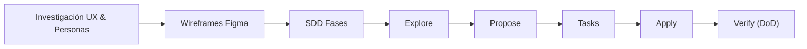

# Flujo de Trabajo (DCU + SDD Adaptativo)

## 1. Integración DCU (Diseño Centrado en el Usuario) + SDD
El proceso de desarrollo articula la investigación de usuario y wireframes de Figma con el ciclo Spec-Driven Development:

## 2. Modalidades Adaptativas de Desarrollo
- **Fast-Path (1 archivo)**: Para correcciones estéticas simples o fixes puntuales en un solo archivo. Se inspecciona, aplica el cambio y verifica visualmente.
- **SDD Completo (> 2 archivos)**: Para nuevos componentes o vistas SPA. Requiere propuesta formal, desglose de tareas, aplicación y verificación estricta.

## 3. Checklist de Listo (Definition of Done - DoD)
Antes de considerar concluida cualquier vista o componente:

- [ ] **Fidelidad Figma**: Alineado con la jerarquía visual de los Frames.
- [ ] **Responsiveness**: Verificado en móvil (375px) y escritorio (1440px) sin scroll horizontal (`overflow-x: hidden`).
- [ ] **Teclado Operable**: Accesible con `Tab`, `Enter` y `Espacio`. Anillo de foco `:focus-visible` bien visible.
- [ ] **5 Estados UI**: Componentes interactivos contienen `Default`, `Hover`, `Active`, `Focus` y `Disabled`.
- [ ] **Validación y Feedback**: Formulario valida en tiempo real y muestra mensajes en lenguaje natural (*✓ Solicitud publicada*).
- [ ] **Accesibilidad WCAG AA**: Contraste texto/fondo $\ge 4.5:1$, imágenes con atributo `alt`, botones con etiquetas semánticas `<button>`.
